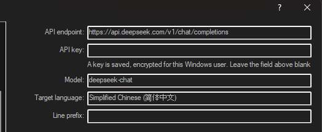

# foo_openlyrics


> **This is a fork of [jacquesh/foo_openlyrics](https://github.com/jacquesh/foo_openlyrics) that adds manual AI lyric translation.**
> Upstream does not include this feature (the maintainer has said [translation is out of scope](https://github.com/jacquesh/foo_openlyrics/issues/170)), so it lives here as a standalone fork. Everything else is unchanged upstream code. Additions are MIT, like the rest of the project.
> 中文说明见 [README.zh-CN.md](README.zh-CN.md).

An open-source lyrics plugin for [foobar2000](https://www.foobar2000.org/) that includes its own UI panel for displaying and sources for downloading lyrics that are not available locally. It is intended to be a replacement for LyricShowPanel3 so it is fully-featured and supports lyric searching, saving and editing directly from within foobar2000.

## Features
* Buttery-smooth lyric scrolling
* Supports retrieving lyrics from local files, ID3 tags or the internet
* Customise the font & colours to perfectly suite your layout & theme
* Supports using album art or any other image as the panel background, with optional transparency and blur
* Easily edit lyrics directly inside foobar2000 with built-in support for timestamps
* Check the saved lyrics of any track in your library (regardless of whether it is currently playing)
* Apply common edits (such as removing blank lines) in just 2 clicks
* **[fork addition]** Translate the lyrics you already have, on demand, with any OpenAI-compatible API — see [below](#ai-lyric-translation-fork-addition)
* ...and more!

## AI lyric translation (fork addition)

Translating is always manual: a song is only translated when you ask for it. Most lyrics don't need a translation at all, and every request costs tokens, so there is no automatic translation anywhere.

### Setup
`Preferences → Tools → OpenLyrics → Translation`

| Setting | Meaning |
|---|---|
| API endpoint | Any endpoint that accepts OpenAI-compatible `chat/completions` requests |
| API key | Encrypted with DPAPI for the current Windows user. It is never stored in plain text in the config database and never logged |
| Model | Model name, for example `deepseek-chat` |
| Target language | Free text, for example `Simplified Chinese (简体中文)` |
| Line prefix | Optional prefix for every translated line, for example `译：`. Empty by default |



### Usage
Right-click the lyric panel, or a track → `OpenLyrics` → **Translate lyrics (AI)**.

* The whole song is sent in one request, not line by line.
* If the lyrics already contain a translation, you are asked whether to translate them again. Only the original lines are sent, so an existing translation is never translated as if it were source text.
* If the response has fewer lines than the request, nothing is saved at all — a translation can never silently shift onto the wrong line.
* Configurable settings are the endpoint, key, model, target language and line prefix. Nothing is downloaded or uploaded behind your back.

### How translations are stored
Each translated line is written directly below its original line, with the same timestamp:

```lrc
[00:28.86]非情な現実に飲み込まれても
[00:28.86]译：即使被无情的现实吞噬
```

Loading that file back merges the pair into a single lyric entry, so the panel highlights the original and its translation together. Any other LRC player shows both lines as well, and removing a translation is as simple as deleting the second line.

Since translating is not treated as a manual edit, `Uploading → Upload lyrics to LRCLIB = After manual edit` will never publish a machine translation.

### Requirements
* foobar2000 v2.x, 64-bit (built and tested with v2.26)
* An OpenAI-compatible chat completions endpoint and an API key for it
* Based on upstream tag `v1.14`

## Building this fork
Upstream ships no build instructions, so briefly:

1. Visual Studio 2022 (Build Tools are enough) with the **C++ workload, ATL and MFC**, plus a Windows SDK (10.0.26100 used here).
2. Fetch the two libraries that are not in the repo — `curl-8.16.0` and `nghttp2-1.67.1` — using the URLs and SHA256 hashes in `3rdparty/fetch-3rdparty-libs.ps1` (the script's own `tar` step fails under some shells; extracting the tarballs manually works).
3. Build `build/cmake-build.vcxproj`, then `3rdparty/pugixml-1.12.1/scripts/pugixml_vs2022_static.vcxproj`, then `build/foo_openlyrics.vcxproj` — in that order, with `/p:SolutionDir=<repo>\build\` (trailing backslash required) and `/p:WindowsTargetPlatformVersion=<your SDK>`. Building the `.sln` as a whole also pulls in a metrics project that needs the .NET SDK.
4. The result is `build/x64/Release/foo_openlyrics.dll`. Copy it to `%APPDATA%\foobar2000-v2\user-components-x64\foo_openlyrics\` and restart foobar2000.

## Screenshots
Fonts & colours are fully configurable


The editor window


## How to install foo_openlyrics
1. Find the latest [release on Github](https://github.com/jacquesh/foo_openlyrics/releases).
2. Download the `fb2k-component` file attached to the release (don't worry about the `debug_symbols` zip file).
3. Double-click on the file you just downloaded. Assuming foobar2000 is installed, it should open up with the installation dialog. Restart foobar2000 when asked.
4. Add the "OpenLyrics Panel" to your layout.

## Why another lyrics plugin?
At the time that I started this, the most widely-used lyrics plugin was [foo_uie_lyrics3](https://www.foobar2000.org/components/view/foo_uie_lyrics3) which had several built-in sources but those had largely stopped working due to the relevant websites going down or otherwise becoming generally unavailable. The original developer seemed to be nowhere in sight though and the source for the plugin did not appear to be available anywhere online. There is an SDK for building one's own sources for foo_uie_lyrics3 but building plugins for plugins didn't really take my fancy. Other (more up-to-date) plugins did exist but were mostly distributed by people posting binaries for you to download from their Dropbox on Reddit. Running binaries published via Dropbox by random people on Reddit did not seem like the most amazing idea.

## Contributing
Please do log an issue or send a pull request if you have found a bug, would like a feature added. If you'd like to support the project you can also make a small donation using any of these links:

[](https://www.buymeacoffee.com/jacquesheunis)
[](https://liberapay.com/jacquesheunis/donate)
