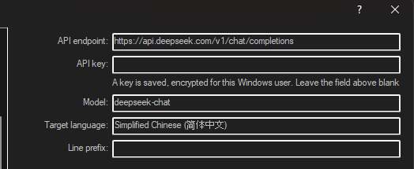

# foo_openlyrics（中文说明）

[English README](README.md)

这是 [jacquesh/foo_openlyrics](https://github.com/jacquesh/foo_openlyrics) 的一个 **fork**，在原版基础上增加了**手动触发、可选的 AI 歌词翻译**功能。

原版不含这个功能（作者在 [issue #170](https://github.com/jacquesh/foo_openlyrics/issues/170) 中表示翻译属于「超出范围」），所以它作为独立分支维护在这里。除本页说明的新增内容外，其余代码与原版一致；新增部分同样以 MIT 许可发布。

---

## 新增了什么

在原版全部功能之上，这一版多了一件事：**按需把已有歌词翻译成另一种语言，并把译文写在原文下面。**

设计上刻意保持克制：

- **只有手动触发，绝不自动翻译**。多数歌词本来就不需要翻译（中文歌、英文歌），而且每次请求都要花钱，所以没有任何后台自动翻译的入口。
- **一首歌一次请求**，不是逐行请求。
- **译文直接写进歌词文件**，用任何 LRC 播放器都能看到原文 + 译文两行。
- **再次翻译有保护**：识别到已翻译的歌词会先问你，且只把原文重新发出去——旧译文绝不会被当成原文再翻一次。
- **失败不落盘**：API 返回的行数少于请求行数时整批放弃，绝不保存错位的译文。

## 使用

### 1. 配置

打开 `Preferences → Tools → OpenLyrics → Translation`：

| 设置项 | 说明 |
|---|---|
| API endpoint | 任何兼容 OpenAI `chat/completions` 的接口地址 |
| API key | 用 Windows DPAPI 按当前用户加密保存，配置文件里没有明文，日志里也不会出现 |
| Model | 模型名，例如 `deepseek-chat` |
| Target language | 想翻译成的语言，自由填写，例如 `Simplified Chinese (简体中文)` |
| Line prefix | 每行译文的前缀，例如 `译：`。默认留空，不想要前缀就不填 |



填完点 Apply。key 那栏在保存后会清空，下面的状态文字会变成「A key is saved, encrypted for this Windows user.」——再次修改其它设置时**把 key 留空即可**，留空表示沿用已保存的 key。

### 2. 翻译

在歌词面板上右键（或在曲目上右键 → `OpenLyrics`）→ **Translate lyrics (AI)**。

- 没有已保存的歌词时，会提示先去搜索歌词。
- 歌词已经翻译过时，会弹窗询问是否重新翻译；确认后只发送原文。
- 翻译过程中有进度窗口，可以中止。

### 3. 存储格式

译文与原文使用**同一个时间戳**，紧跟在原文下一行：

```lrc
[00:28.86]非情な現実に飲み込まれても
[00:28.86]译：即使被无情的现实吞噬
```

重新加载该文件时，同一时间戳的两行会被合并成一条歌词，所以面板里原文和译文会**同时高亮**，滚动也把它们当作一个整体。

换到其它 LRC 播放器同样正常显示两行；不想要译文时，直接删掉第二行即可还原。

翻译**不算人工编辑**，所以即使你打开了 `Uploading → Upload lyrics to LRCLIB = After manual edit`，机翻结果也不会被上传到 LRCLIB。

### 4. 排查问题

日志在 foobar2000 的 **View → Console**：

- `ERROR` / `WARN` 级别总是输出。
- `INFO` 级别需要开启 verbose：在 `%APPDATA%\foobar2000-v2\` 下放一个名为 `openlyrics-verbose-log.txt` 的空文件即可。

翻译链路会打印这些行，便于判断问题出在鉴权、额度、模型输出还是网络：

```
INFO: Translating 42 lyric lines into Simplified Chinese using deepseek-chat (endpoint: ...)
INFO: AI translation: HTTP status 200 OK
INFO: AI translation: received 1883 bytes
INFO: AI translation: parsed 42 of 42 lines
```

## 安装

本 fork 不提供现成的 release 包，需要自行编译（见下），然后把生成的 DLL 放进：

```
%APPDATA%\foobar2000-v2\user-components-x64\foo_openlyrics\foo_openlyrics.dll
```

替换前建议把官方版本的 DLL 改名备份（例如 `foo_openlyrics.dll.v1.14-official.bak`），想回到原版随时换回来。

## 编译

基于原版 tag `v1.14`。原版没有提供编译说明，这里简述实测可用的方式：

1. Visual Studio 2022（Build Tools 即可），需要 **C++ 工作负载 + ATL/MFC**，以及 Windows SDK（本机用的是 `10.0.26100`）。
2. 补齐仓库里没有的两个第三方库：`curl-8.16.0` 与 `nghttp2-1.67.1`。按 `3rdparty/fetch-3rdparty-libs.ps1` 里的 URL 和 SHA256 自行下载并解压到 `3rdparty/`（该脚本自带的 `tar` 步骤在某些 shell 下会失败）。
3. **按顺序**单独编译三个工程，而不是整个 `.sln`：

   ```
   build\cmake-build.vcxproj
   3rdparty\pugixml-1.12.1\scripts\pugixml_vs2022_static.vcxproj
   build\foo_openlyrics.vcxproj
   ```

   共同参数：`/p:Configuration=Release /p:Platform=x64 /p:SolutionDir=<仓库路径>\build\`（末尾反斜杠必须保留）、`/p:WindowsTargetPlatformVersion=<你的 SDK 版本>`、`/nodeReuse:false`。

   直接编译整个 `.sln` 会带上依赖 .NET SDK 的 metrics 工程，因此绕开。
4. 产物为 `build\x64\Release\foo_openlyrics.dll`。

## 已知限制

- 只处理「原文本 + 译文」两层；如果歌词本身已经是人工双语版（同一时间戳两行），会被识别为「已翻译」，重新翻译会替换掉原有译文。
- 逐行协议要求模型按编号返回，模型不听话时会整批失败（不会写出半成品）。
- 只在 foobar2000 v2.x 64 位、v2.26 上实测过。

## 许可

原项目为 MIT 许可，版权归 Jacques Heunis 所有；本 fork 的新增部分同样以 MIT 发布。
